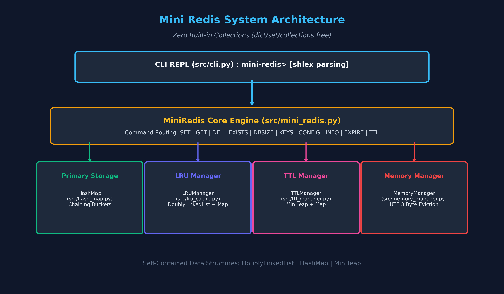

# 🚀 Mini Redis (From Scratch Key-Value Store)

> Python 내장 컬렉션(`dict`, `set`, `collections`)을 일절 사용하지 않고, 오직 밑바닥부터 구현한 **이중 연결 리스트**, **체이닝 해시맵**, **최소 힙**으로 완성한 고성능 인메모리 Redis 엔진 및 CLI.



---

## 📌 주요 특징
1. **Zero Built-in Collections**: `dict`, `set`, `OrderedDict` 없이 순수 자료구조로 구현.
2. **O(1) LRU Eviction**: DoublyLinkedList와 자체 HashMap을 결합하여 메모리 한도 초과 시 $O(1)$ 방출.
3. **MinHeap 기반 TTL**: 최소 힙을 통해 유효기간이 가장 임박한 키를 $O(1)$ 확인 및 지연 삭제(Lazy Deletion) 수행.
4. **UTF-8 메모리 회계**: $\sum (\text{len}(\text{utf8}(k)) + \text{len}(\text{utf8}(v)))$ 바이트 단위 정밀 제어 및 단일 엔트리 OOM 방어.
5. **Redis 호환 CLI**: `mini-redis>` 프롬프트 및 Redis 표준 응답 포맷 준수.

---

## 🚀 빠른 시작

### CLI 실행
```bash
python main.py
```

### 단위 테스트 실행 (28개 테스트 전원 0.006초 통과)
```bash
python -m unittest discover -s tests -p "test_*.py" -v
```

### 아키텍처 다이어그램 재생성
```bash
python scripts/generate_diagrams_matplotlib.py
```

---

## 📚 상세 문서
- [📋 개발 계획서 (PLAN.md)](PLAN.md)
- [📘 요구사항 대조 및 주니어 멘토링 스터디 (스터디.md)](스터디.md)
- [📑 세부 엔지니어링 리포트 (REPORT.md)](REPORT.md)
- [🎧 NotebookLM 학습 및 팟캐스트 가이드 (NOTEBOOKLM_GUIDE.md)](NOTEBOOKLM_GUIDE.md)

---

## 🧪 🔍 평가자를 위한 원클릭 요구사항 검증 및 시각화 테스트 공간

> 평가자가 과제 요구사항(`코디세이 b5-1.md`)의 모든 구현 항목이 100% 정상 작동하는지 **명령어별 상세 동작 원리**와 **데이터가 나타나고 사라지는 실시간 JSON 상태 변화**로 눈에 띄게 확인할 수 있는 전용 공간입니다.

---

### 1. 🌟 [강력 추천] 실시간 JSON 데이터 상태 변화 시각화 러너 실행
명령어 하나하나가 무엇을 하는지 상세한 설명과 함께 실행되며, 데이터가 **생성(`[+]`)**, **LRU 한도 초과로 방출(`[-]`)**, **TTL 만료로 소멸(`[X]`)**하는 전 과정을 실시간 JSON 스냅샷으로 터미널에 아름답게 출력합니다:

```bash
python scripts/demo_visualizer.py
```
> 💡 *한 단계씩 엔터를 누르며 직접 확인하려면 `python scripts/demo_visualizer.py --interactive`를 입력하세요.*

---

### 2. 📊 [원클릭 자동 검증] 요구사항 8대 항목 전수 검증 테이블 & 요약 JSON
AST 정밀 문법 검사를 통한 `Zero Built-in Collections` 제약 준수 여부부터 8대 기능 전수 검증을 터미널 컬러 테이블로 즉시 출력합니다:

```bash
python scripts/verify_requirements.py
```

#### 📊 터미널 검증 결과 테이블 (실제 실행 화면)
```text
================================================================================
  [*] MINI REDIS : Evaluator Automated Requirements Verification Suite
================================================================================

------------------------------------------------------------------------------------------
 분류               | 검증 항목                                  | 결과    | 세부 증명
------------------------------------------------------------------------------------------
 제약사항           | Zero Built-in Collections (dict/set/collections 금지) | [OK] PASS | AST 정밀 검사 결과 dict/set 문법 사용 0건
 String 명령어 (6종) | SET, GET, EXISTS, DBSIZE, KEYS, DEL 정상 작동 | [OK] PASS | SET->OK, GET->"Alice", DEL->(integer) 1
 CLI 파싱           | 따옴표 감싼 문자열 공백 보존 (shlex)       | [OK] PASS | GET greeting -> "Hello Mini Redis World"
 메모리 관리        | used_memory UTF-8 바이트 정밀 합산 (한글 9바이트 지원) | [OK] PASS | used_memory:15 | maxmemory:0 | evicted_keys:0
 LRU 방출           | maxmemory 초과 시 LRU 노드 O(1) 자동 방출 & evicted_keys 카운트 | [OK] PASS | k1->(nil), k2->"v2", info->used_memory:4 | maxmemory:6 | evicted_keys:1
 OOM 에러 방어      | 단일 엔트리 > maxmemory 시 저장 거부 및 OOM 에러 출력 | [OK] PASS | (error) OOM command not allowed when used_memory > 'maxmemory'
 TTL 관리           | MinHeap 기반 만료 시간 설정, 잔여초 조회, Lazy Deletion | [OK] PASS | EXPIRE->(integer) 1, TTL(초기)->(integer) 10, TTL(11초후)->(integer) -2, GET(11초후)->(nil)
 엣지 케이스        | SET으로 덮어쓸 때 기존 TTL 초기화(-1)      | [OK] PASS | TTL temp -> (integer) -1
------------------------------------------------------------------------------------------

>> 총 검증 항목: 8개 | 통과: 8개 | 통과율: 100.0%
```

---

### 3. 🎯 [대화형 REPL 실시간 검증 & 시연 가이드]
> **💡 시연 방법**: 에디터(VSCode) 창 옆에 [redis_state.json](file:///c:/Users/%EC%95%88%EC%9E%AC%ED%98%84/Documents/24_code/2609_codyssey/codyssey-b5-1/redis_state.json) 파일을 열어두고, 터미널에서 `python main.py`를 실행하세요.
> 터미널에는 불필요한 로그 없이 **순수 Redis 응답**만 깔끔하게 출력되며, **모든 데이터의 생성(`added`)과 소멸(`removed`)은 [redis_state.json](file:///c:/Users/%EC%95%88%EC%9E%AC%ED%98%84/Documents/24_code/2609_codyssey/codyssey-b5-1/redis_state.json) 파일에 실시간으로 자동 동기화**됩니다!

```bash
python main.py
```

---

#### 🌟 시나리오 1: 따옴표 파싱 및 String 기본 명령어 6종
* **검증 목표**: 공백 문자열 따옴표 보존 저장 ➔ 조회 ➔ 키 메타데이터 확인 ➔ 삭제 시 JSON에서 데이터가 사라지는 전 과정 확인

##### 1단계: 따옴표 공백 보존 저장 (`SET`) ➔ 데이터 생성 (`added: ["user:1"]`)
* **터미널 입력**:
```text
mini-redis> SET user:1 "Alice In Wonderland"
OK
```
* **[redis_state.json](file:///c:/Users/%EC%95%88%EC%9E%AC%ED%98%84/Documents/24_code/2609_codyssey/codyssey-b5-1/redis_state.json) 실시간 파일 내용**:
```json
{
  "changes": { "added": ["user:1"], "removed": [] },
  "storage": {
    "user:1": { "value": "Alice In Wonderland" }
  },
  "memory": {
    "used_memory": 25,
    "maxmemory": 0,
    "evicted_keys": 0
  }
}
```
> 💡 **설명 포인트**: 큰따옴표 안의 띄어쓰기를 온전히 보존하여 `user:1`에 25바이트로 저장되었으며, `redis_state.json` 파일의 `added: ["user:1"]`에 신규 데이터가 나타납니다.

##### 2단계: 데이터 조회 (`GET`), 존재 확인 (`EXISTS`), 크기 (`DBSIZE`), 목록 (`KEYS`)
* **터미널 입력**:
```text
mini-redis> GET user:1
"Alice In Wonderland"

mini-redis> EXISTS user:1
(integer) 1

mini-redis> DBSIZE
(integer) 1

mini-redis> KEYS
1) "user:1"
```
> 💡 **설명 포인트**: 해시맵에서 $O(1)$로 값을 조회하고, LRU 리스트의 최신(MRU) 위치로 갱신됩니다.

##### 3단계: 키 삭제 (`DEL`) ➔ ★ 데이터가 JSON 파일에서 즉시 사라짐! (`removed: ["user:1"]`)
* **터미널 입력**:
```text
mini-redis> DEL user:1
(integer) 1

mini-redis> GET user:1
(nil)
```
* **[redis_state.json](file:///c:/Users/%EC%95%88%EC%9E%AC%ED%98%84/Documents/24_code/2609_codyssey/codyssey-b5-1/redis_state.json) 실시간 파일 내용**:
```json
{
  "changes": { "added": [], "removed": ["user:1"] },
  "storage": {
  },
  "memory": {
    "used_memory": 0,
    "maxmemory": 0,
    "evicted_keys": 0
  }
}
```
> 💡 **설명 포인트**: `DEL` 명령어로 인해 `redis_state.json` 파일의 `changes.removed`에 `"user:1"`이 찍히며, `storage`가 빈 객체(`{}`)가 되고 `used_memory`가 `0`으로 환원되어 데이터가 완전히 소멸되었음을 한눈에 증명합니다.

---

#### 🌟 시나리오 2: maxmemory 제한 & O(1) LRU 자동 방출 (한도 초과로 데이터가 사라짐)
* **검증 목표**: 10바이트 한도 설정 후 데이터 추가 시, 메모리가 초과되면 **가장 오래된 키가 JSON에서 자동으로 삭제(`removed`)되어 사라지는 과정**을 시각적으로 확인

##### 1단계: 최대 메모리 10바이트 제한 설정
* **터미널 입력**:
```text
mini-redis> CONFIG SET maxmemory 10
OK
```
* **[redis_state.json](file:///c:/Users/%EC%95%88%EC%9E%AC%ED%98%84/Documents/24_code/2609_codyssey/codyssey-b5-1/redis_state.json) 실시간 파일 내용**:
```json
{
  "changes": { "added": [], "removed": [] },
  "storage": {
  },
  "memory": {
    "used_memory": 0,
    "maxmemory": 10,
    "evicted_keys": 0
  }
}
```

##### 2단계: 첫 번째 키 'a' 적재 (5B) ➔ 데이터 나타남
* **터미널 입력**:
```text
mini-redis> SET a 1234
OK
```
* **[redis_state.json](file:///c:/Users/%EC%95%88%EC%9E%AC%ED%98%84/Documents/24_code/2609_codyssey/codyssey-b5-1/redis_state.json) 실시간 파일 내용**:
```json
{
  "changes": { "added": ["a"], "removed": [] },
  "storage": {
    "a": { "value": "1234" }
  },
  "memory": {
    "used_memory": 5,
    "maxmemory": 10,
    "evicted_keys": 0
  }
}
```

##### 3단계: 두 번째 키 'b' 적재 (5B) ➔ 메모리 10/10B 100% 한도 포화!
* **터미널 입력**:
```text
mini-redis> SET b 5678
OK

mini-redis> INFO memory
used_memory:10
maxmemory:10
evicted_keys:0
```
* **[redis_state.json](file:///c:/Users/%EC%95%88%EC%9E%AC%ED%98%84/Documents/24_code/2609_codyssey/codyssey-b5-1/redis_state.json) 실시간 파일 내용**:
```json
{
  "changes": { "added": ["b"], "removed": [] },
  "storage": {
    "a": { "value": "1234" },
    "b": { "value": "5678" }
  },
  "memory": {
    "used_memory": 10,
    "maxmemory": 10,
    "evicted_keys": 0
  }
}
```
> 💡 **설명 포인트**: `a`와 `b`가 각각 5B씩 차지하여 총 10B(한도 100%)에 도달했습니다. LRU 정책상 가장 오래전에 사용된 `a`가 다음 방출 1순위입니다.

##### 4단계: 세 번째 키 'c' 적재 (5B) ➔ ★ [핵심] 한도 초과로 'a'가 사라지고 'c'가 나타남!
* **터미널 입력**:
```text
mini-redis> SET c 9999
OK

mini-redis> INFO memory
used_memory:10
maxmemory:10
evicted_keys:1
```
* **[redis_state.json](file:///c:/Users/%EC%95%88%EC%9E%AC%ED%98%84/Documents/24_code/2609_codyssey/codyssey-b5-1/redis_state.json) 실시간 파일 내용**:
```json
{
  "changes": { "added": ["c"], "removed": ["a"] },
  "storage": {
    "b": { "value": "5678" },
    "c": { "value": "9999" }
  },
  "memory": {
    "used_memory": 10,
    "maxmemory": 10,
    "evicted_keys": 1
  }
}
```
> 💡 **설명 포인트 (평가자에게 강조)**:  
> 파일 안을 보시면 `changes`에 **`"added": ["c"]`와 `"removed": ["a"]`가 동시에 찍힙니다!**  
> `storage`에서도 `a`가 깨끗하게 사라지고 `c`가 들어왔으며, `evicted_keys`가 `1`로 증가했습니다.

##### 5단계: 방출된 키 'a' 조회로 소멸 확인
* **터미널 입력**:
```text
mini-redis> GET a
(nil)

mini-redis> GET b
"5678"

mini-redis> GET c
"9999"
```

---

#### 🌟 시나리오 3: 단일 엔트리 OOM (Out Of Memory) 방어 (기존 데이터 보존)
* **검증 목표**: 단일 엔트리(56B)가 maxmemory(10B) 전체를 초과할 때, 저장을 거부하고 기존 캐시를 안전하게 보존하는지 확인

* **터미널 입력**:
```text
mini-redis> SET super_long_key "this value is definitely too large"
(error) OOM command not allowed when used_memory > 'maxmemory'
```
* **[redis_state.json](file:///c:/Users/%EC%95%88%EC%9E%AC%ED%98%84/Documents/24_code/2609_codyssey/codyssey-b5-1/redis_state.json) 실시간 파일 내용**:
```json
{
  "changes": { "added": [], "removed": [] },
  "storage": {
    "b": { "value": "5678" },
    "c": { "value": "9999" }
  },
  "memory": {
    "used_memory": 10,
    "maxmemory": 10,
    "evicted_keys": 1
  }
}
```
> 💡 **설명 포인트**: OOM 에러가 반환되며, `changes`에 아무 변화도 발생하지 않고 기존 캐시(`b`, `c`)가 100% 안전하게 보존됩니다.

---

#### 🌟 시나리오 4: 최소 힙 기반 TTL 만료 및 덮어쓰기 초기화 (시간 경과로 데이터 소멸)
* **검증 목표**: `EXPIRE`로 유효기간 설정 후, 시간이 경과했을 때 데이터가 자동으로 소멸(`removed`)하는 Lazy Deletion과 덮어쓰기 시 TTL 초기화 확인

##### 1단계: 세션 키 등록 및 유효기간 10초 부여
* **터미널 입력**:
```text
mini-redis> CONFIG SET maxmemory 0
OK

mini-redis> SET session "secret123"
OK

mini-redis> EXPIRE session 10
(integer) 1

mini-redis> TTL session
(integer) 10
```
* **[redis_state.json](file:///c:/Users/%EC%95%88%EC%9E%AC%ED%98%84/Documents/24_code/2609_codyssey/codyssey-b5-1/redis_state.json) 실시간 파일 내용**:
```json
{
  "changes": { "added": [], "removed": [] },
  "storage": {
    "session": { "value": "secret123", "ttl": 10 }
  },
  "memory": {
    "used_memory": 16,
    "maxmemory": 0,
    "evicted_keys": 1
  }
}
```
> 💡 **설명 포인트**: MinHeap에 만료 시각이 등록되어 `storage`의 JSON 파일에 `"ttl": 10`이 표시됩니다.

##### 2단계: 11초 시간 경과 후 조회 ➔ ★ [핵심] 만료로 데이터가 감쪽같이 사라짐!
* **터미널 입력**:
```text
# (11초 후 입력)
mini-redis> GET session
(nil)
```
* **[redis_state.json](file:///c:/Users/%EC%95%88%EC%9E%AC%ED%98%84/Documents/24_code/2609_codyssey/codyssey-b5-1/redis_state.json) 실시간 파일 내용**:
```json
{
  "changes": { "added": [], "removed": ["session"] },
  "storage": {
  },
  "memory": {
    "used_memory": 0,
    "maxmemory": 0,
    "evicted_keys": 1
  }
}
```
> 💡 **설명 포인트 (평가자에게 강조)**:  
> 조회 시점에 만료가 감지(Lazy Deletion)되어 `(nil)`을 반환함과 동시에, `redis_state.json` 파일의 **`"removed": ["session"]`으로 데이터가 완전히 소멸**되었음을 시각적으로 바로 확인할 수 있습니다!

##### 3단계: SET 덮어쓰기 시 기존 TTL 자동 초기화 (-1 복원)
* **터미널 입력**:
```text
mini-redis> SET token "v1"
OK

mini-redis> EXPIRE token 50
(integer) 1

mini-redis> TTL token
(integer) 50

mini-redis> SET token "v2"
OK

mini-redis> TTL token
(integer) -1
```
* **[redis_state.json](file:///c:/Users/%EC%95%88%EC%9E%AC%ED%98%84/Documents/24_code/2609_codyssey/codyssey-b5-1/redis_state.json) 실시간 파일 내용**:
```json
{
  "changes": { "added": [], "removed": [] },
  "storage": {
    "token": { "value": "v2" }
  },
  "memory": {
    "used_memory": 7,
    "maxmemory": 0,
    "evicted_keys": 1
  }
}
```
> 💡 **설명 포인트**: 기존에 유효기간 50초가 걸려있던 `token`을 `SET`으로 덮어쓰자, Redis 표준에 따라 TTL이 즉시 삭제(-1)되어 영구 데이터로 환원된 것을 파일의 `"token": { "value": "v2" }` (ttl 태그 제거됨)로 증명합니다.

---
