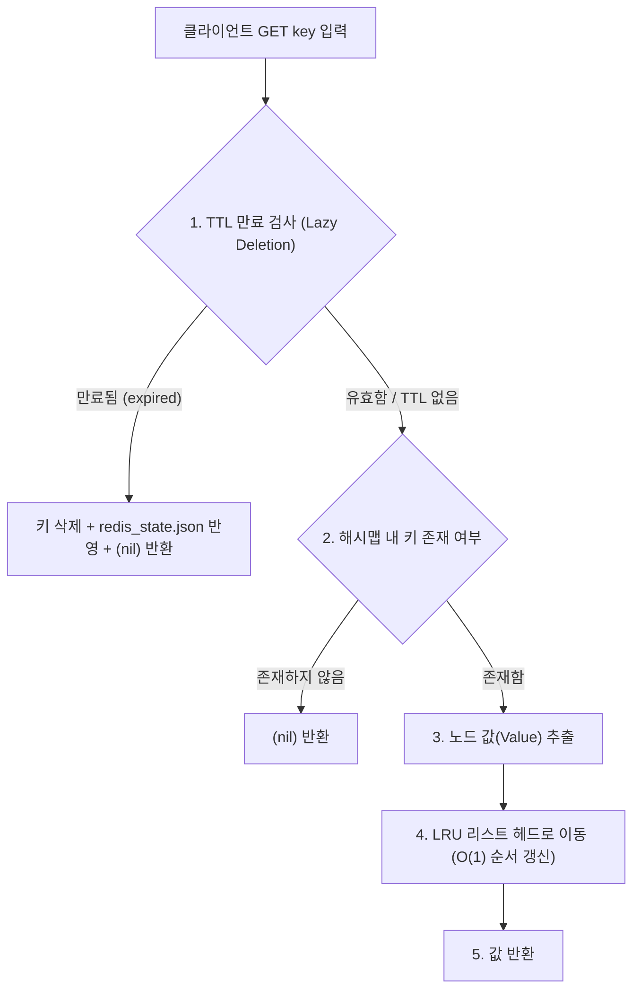

## 💡 프로젝트 기술 심층 인터뷰 & 검증 Q&A (평가 대비 가이드)

본 프로젝트의 설계 원칙, 자료구조 선택 이유, 내부 동작 흐름 및 확장성에 대한 핵심 질문과 모범 답변 정리입니다.

---

### 📌 항목 1. 기능 검증 체크리스트

| 검증 항목 | 검증 대상 및 규칙 | 동작 확인 및 증명 |
| :--- | :--- | :--- |
| **String 기본 동작** | `SET`, `GET`, `DEL`, `EXISTS`, `DBSIZE`, `KEYS` | ✅ 정상 동작. 대소문자 무관 명령 처리, `DBSIZE` O(1), `KEYS *` 패턴 매칭 지원 |
| **LRU 자동 제거** | `maxmemory` 초과 시 가장 오래 미사용된 키 자동 삭제 | ✅ 메모리 임계치 도달 시 O(1)로 Tail 직전 노드 선별 및 제거 (OOM 사전 방지) |
| **메모리 정보 출력** | `INFO memory` 명령어로 상태 확인 | ✅ `used_memory`, `maxmemory`, `evicted_keys` 3대 핵심 지표 정확한 포맷 출력 |
| **TTL 수명 주기 관리** | `EXPIRE`, `TTL`, 만료 키 자동 소멸 | ✅ 만료 키 조회 시 즉시 소멸(Lazy) + `redis_state.json`의 `"removed"` 실시간 반영 |
| **표준 에러 처리** | 오타, 인자 누락, 정수 파싱 실패, OOM 에러 | ✅ Redis 공식 표준 규격(`(error) ERR ...`)에 맞춘 명확한 에러 메시지 반환 |

---

### 📌 항목 2. 핵심 자료구조 심층 분석 (Data Structures)

#### Q1. 이중 연결 리스트(Doubly Linked List)의 노드 구조와 핵심 메서드들의 O(1) 동작 원리는?
* **노드 구조**:
  ```python
  class Node:
      def __init__(self, key=None, value=None, data=None):
          self.key = key
          self.value = value
          self.data = data or (key, value)
          self.prev = None  # 이전 노드 포인터
          self.next = None  # 다음 노드 포인터
  ```
* **더미 헤드/테일(Sentinel Nodes)을 통한 O(1) 달성**:
  * 리스트 양 끝에 실제 데이터가 없는 `dummy head`와 `dummy tail`을 영구 배치했습니다.
  * 리스트가 비어 있거나 노드가 1개만 남았을 때의 조건 분기(`if head is None`)를 원천 제거했습니다.
  * `insert_front(node)`: `head`와 `head.next` 사이에 노드를 끼워 넣는 4개의 포인터 재연결만으로 **O(1)** 달성.
  * `remove_node(node)`: 대상 노드의 `prev.next = node.next`, `next.prev = node.prev` 연결로 **O(1)** 달성.
  * `move_to_front(node)`: `remove_node(node)` 후 `insert_front(node)`를 순차 실행하여 **O(1)** 이동 달성.

#### Q2. 직접 설계한 해시 함수는 어떤 입력을 받아 어떤 과정을 거쳐 인덱스를 만드는가?
* **알고리즘**: 표준 문자열 해시로 널리 검증된 **djb2 알고리즘**을 정밀 변형하여 구현했습니다.
* **변환 과정**:
  1. **입력 변환**: 입력 키를 문자열(`str(key)`)로 정규화합니다.
  2. **매직 넘버 소수 5381 초기화**: 해시 초기값 `h = 5381` 설정.
  3. **비트 시프트 및 소수 곱셈**: 각 문자의 ASCII 코드값을 순회하며 `h = ((h << 5) + h) + ord(char)` (즉, $h \times 33 + c$) 연산을 수행하여 비트의 눈태 효과(Avalanche Effect)를 극대화합니다.
  4. **양수 비트 마스킹**: 파이썬 정수 오버플로를 방지하고 부호 비트를 통제하기 위해 `h & 0x7FFFFFFF` (31비트 양수) 적용.
  5. **모듈러 연산**: 최종 해시값을 현재 버킷 크기로 나누어(`h % capacity`) 최종 버킷 인덱스를 도출합니다.

#### Q3. 해시 충돌(Hash Collision)은 체이닝 방식으로 어떻게 해결했는가?
* **버킷 내부 구조**:
  * 파이썬 내장 `dict`, `set`, `list`를 사용하지 않고, 각 버킷 슬롯을 직접 구현한 **`DoublyLinkedList` 인스턴스**로 초기화했습니다.
* **동작 방식**:
  * 충돌이 발생하면 해당 버킷 인덱스의 `DoublyLinkedList` 끝에 새 노드를 삽입(`insert_back`)합니다.
  * 동일 키가 들어올 경우 버킷 리스트를 순회하며 노드의 `key`를 비교해 값을 덮어씁니다(O(1) 평균 시간).

#### Q4. 로드 팩터 0.75 초과 시 "버킷 2배 확장(Rehashing)"은 어떤 절차로 수행하는가?
* **임계치 검사**: `put()` 연산마다 `load_factor = _size / _capacity`를 측정하여 `0.75`를 넘어서면 확장을 트리거합니다.
* **수행 절차**:
  1. 새 용량 `new_capacity = _capacity * 2` 크기의 새로운 버킷 배열을 생성합니다.
  2. 기존 버킷 배열의 모든 연결 리스트를 순회하며 저장된 모든 `(key, value)` 노드를 추출합니다.
  3. 새로운 `new_capacity`를 기준으로 각 키의 해시 인덱스(`_hash(key) % new_capacity`)를 **재계산(Rehashing)**합니다.
  4. 재계산된 새 버킷 리스트에 노드들을 재배치하여 충돌 체인 길이를 최소화하고 O(1) 탐색 성능을 복원합니다.

---

### 📌 항목 3. 아키텍처 및 동작 메커니즘 (Architecture)

#### Q1. LRU 캐시 구현에서 "해시맵 + 이중 연결 리스트"의 역할 분담과 둘 다 필요한 이유는?
* **해시맵(HashMap)의 역할**: **O(1) 탐색/접근 보장**. 특정 키가 캐시에 있는지 여부와 해당 키의 노드 포인터 주소를 즉시 조회합니다.
* **이중 연결 리스트(DoublyLinkedList)의 역할**: **O(1) 순서 갱신/제거 보장**. 데이터가 언제 사용되었는지 시간적 순서(Recency)를 물리적인 링크 관계로 유지합니다.
* **둘 다 필요한 이유**:
  * **리스트만 사용 시**: 순서 변경은 빠르지만, 특정 키를 찾는 탐색 비용이 **O(N)**으로 저하됩니다.
  * **해시맵만 사용 시**: 탐색은 O(1)이지만, 어떤 키가 가장 오래되었는지 찾기 위해 전체 키를 **O(N)** 전수 조사해야 합니다.
  * ➡️ **두 구조의 결합**: 해시맵에 `Node` 객체의 직접 참조를 저장하여, **탐색(O(1)) + 최근 위치로 이동(O(1)) + 최구형 데이터 축출(O(1))**을 모두 O(1)에 완성합니다.

#### Q2. O(1) LRU 달성 원리를 "조회"와 "갱신" 관점에서 설명하면?
* **조회(해시맵)**: `hash_map.get_node(key)`를 호출하여 체이닝 버킷에서 대상 `Node` 객체의 참조를 O(1)에 바로 가져옵니다.
* **갱신(리스트 이동)**: 찾아낸 노드를 기존 위치의 앞뒤 포인터 연결(`remove_node`)로 떼어낸 뒤, `DoublyLinkedList`의 더미 헤드 바로 뒤(`insert_front`)로 붙여줍니다. 
* ➡️ 임의의 중간 노드를 분리하고 맨 앞으로 옮기는 모든 과정이 고정된 포인터 변경 연산 4~6회로 끝나므로 **완벽한 O(1)**입니다.

#### Q3. TTL 관리에 최소 힙(Min-Heap)을 채택한 이유는?
* **만료 시점의 정렬 특성**:
  * 만료 시각(`expire_at`)은 연속적인 실수(timestamp)입니다.
  * 가장 시급하게 삭제해야 할 키는 **`expire_at`이 가장 작은 키**입니다.
* **O(1) 만료 감지와 O(log K) 관리**:
  * Min-Heap의 루트 노드는 항상 캐시 내에서 **가장 먼저 만료될 데이터**를 가리킵니다.
  * 만료 여부 판별 시 전체 N개 키를 검사할 필요 없이, 루트(`heap[0]`)만 O(1)로 확인(`peek`)하면 됩니다.
  * 만료되지 않았다면 뒤의 키들도 검사할 필요가 없으므로 연산량이 획기적으로 절약됩니다.

#### Q4. 메모리 초과 시 Eviction(축출) 흐름은 단계별로 어떻게 일어나는가?
1. **용량 예측**: 신규 키 저장 또는 기존 키 값 수정 시, 증분 메모리를 계산하여 `used_memory + delta > maxmemory`인지 사전 검사합니다 (`maxmemory > 0`인 경우).
2. **축출 대상 선정**: 메모리가 부족하면 LRU 리스트의 `tail.prev`(가장 오랫동안 조회/수정되지 않은 노드)를 타깃으로 잡습니다.
3. **원자적 제거**:
   * LRU 리스트에서 해당 노드를 제거합니다.
   * 메인 `HashMap` 및 `TTLManager` 힙에서도 해당 키를 완전히 삭제합니다.
4. **메트릭 갱신**: 제거된 키와 값의 바이트 크기만큼 `used_memory`를 차감하고, `evicted_keys` 카운터를 1 증가시킵니다.
5. **반복 확보**: 새 데이터를 수용할 수 있을 만큼의 메모리가 확보될 때까지 2~4단계를 루프로 반복합니다.

#### Q5. `GET` 명령어의 전체 처리 흐름은?


---

### 📌 항목 4. 심화 및 확장성 논의 (Deep Dive & Scalability)

#### Q1. LRU 대신 LFU(Least Frequently Used) 정책을 구현한다면 자료구조를 어떻게 변경해야 하는가?
* **단순 접근의 한계**: 빈도(Frequency) 순으로 정렬된 단일 연결 리스트를 사용하면 빈도 증가 시 재배치에 **O(N)**이 걸립니다.
* **O(1) LFU 자료구조 설계 (2-Level Hash Map & Doubly Linked List)**:
  1. `key_table`: `key -> Node(key, value, freq)` (키로 노드를 O(1) 탐색)
  2. `freq_table`: `freq -> DoublyLinkedList` (빈도수마다 해당 빈도를 가진 키들의 LRU 리스트 유지)
  3. `min_freq` 포인터: 현재 캐시에서 가장 낮은 빈도수를 정수형으로 항시 추적.
* **동작 메커니즘**:
  * **조회 시 (GET)**: 노드의 `freq`를 `f`에서 `f + 1`로 증가시키고, `freq_table[f]`에서 제거하여 `freq_table[f + 1]`의 헤드로 이동. 만약 `freq_table[min_freq]`가 비었다면 `min_freq += 1`.
  * **축출 시 (Eviction)**: `freq_table[min_freq]` 리스트의 가장 오래된 끝 노드(Tail)를 O(1)로 제거.

#### Q2. 데이터가 10만 건 이상으로 대규모화될 때의 병목 지점과 개선책은?
1. **리사이징 시 Latency Spike (순간 지연 현상)**:
   * **원인**: 10만 건의 데이터를 가진 해시맵이 2배 확장될 때 한 번에 모든 노드를 Rehashing하면 수백 ms의 이벤트 루프 블로킹이 발생합니다.
   * **개선책**: Redis 공식 아키텍처와 같은 **점진적 리해싱(Progressive Rehashing)** 도입. 2개의 버킷 테이블을 두고 클라이언트 요청이 들어올 때마다 인덱스를 1씩 점진 이전.
2. **`KEYS *` 및 전체 순회 명령어의 블로킹**:
   * **원인**: 10만 개 버킷을 O(N)으로 순회하면 단일 스레드 구조에서 타 명령어 처리가 마비됩니다.
   * **개선책**: 커서 기반의 비차단 순회 명령어인 **`SCAN`** 명령어 도입.
3. **만료 힙(Min-Heap)의 메모리 및 O(log N) 비용**:
   * **원인**: 10만 개 키 전체가 TTL을 가질 경우 힙 조정 비용 증가.
   * **개선책**: 모든 키를 힙에 넣는 대신, Redis 방식의 **Active Expiration 확률적 샘플링(매초 무작위 20개 키를 검사하여 만료 키 비율이 25% 이하가 될 때까지 정리)** 도입.

#### Q3. `used_memory`에 자료구조 오버헤드까지 포함하는 모델로 바꾸면 무엇이 달라지며, 어떻게 보정해야 하는가?
* **달라지는 점**:
  * 현재 모델은 `len(key) + len(value)` 순수 데이터 바이트만 측정합니다.
  * 실제 메모리 모델을 적용하면 파이썬 객체 헤더(`PyObject_HEAD` 약 56~64B), `Node`의 포인터 3개(각 8B), 해시맵 버킷 배열 포인터 등 **키 하나당 약 150~200바이트의 메타데이터 오버헤드**가 추가됩니다.
  * 결과적으로 순수 데이터 크기보다 오버헤드가 더 커져 동일한 `maxmemory` 조건에서 Eviction이 훨씬 빈번하게 일어납니다.
* **공정한 비교와 측정을 위한 보정 방안**:
  1. **고정 메타 오버헤드 상수화(Deterministic Model)**:
     $$\text{key\_mem} = \text{len(key)} + \text{len(val)} + \text{OVERHEAD\_NODE\_BYTES (예: 64)}$$
     상수 오버헤드를 규칙화하여 가상 머신이나 OS 의존성 없이 공정하게 계산.
  2. **Jemalloc / Zmalloc 추정 비율 적용**:
     실제 Redis가 C의 메모리 단편화와 메타데이터를 관리하듯, 메모리 정렬(Memory Alignment, 8바이트 단위 올림) 및 고정 할당자 패딩을 시뮬레이션하는 산출 함수를 작성하여 벤치마크 신뢰도를 확보합니다.