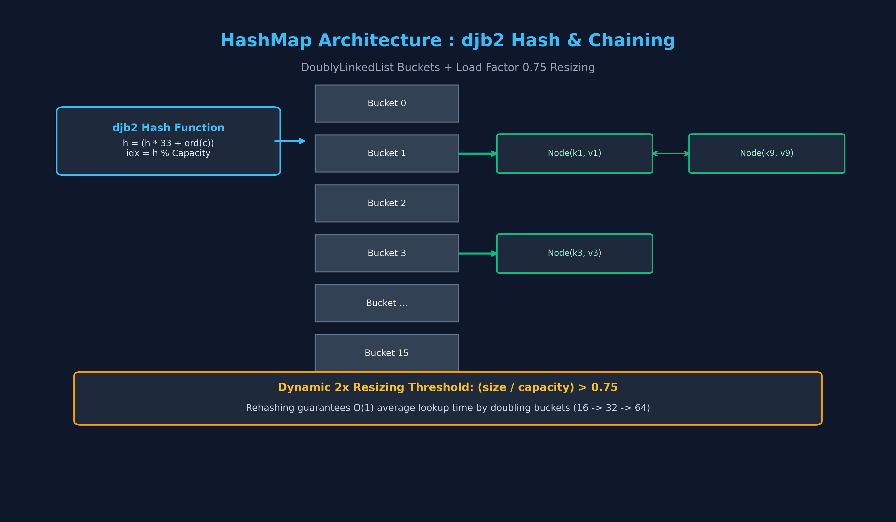
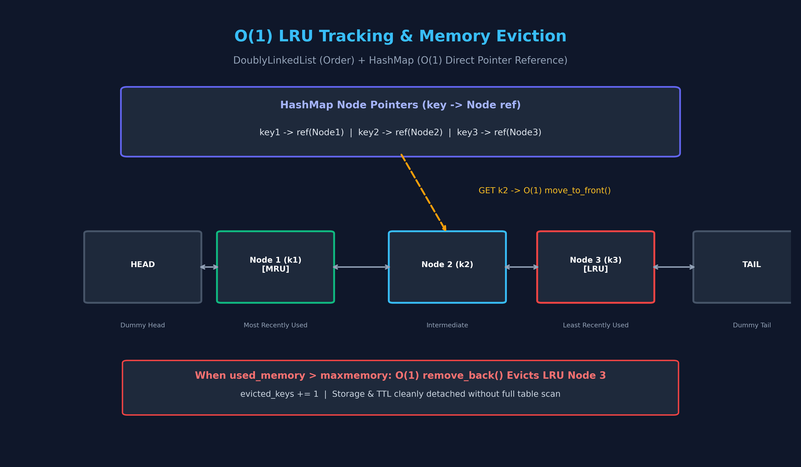
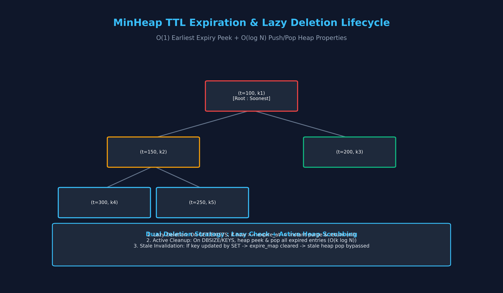

# 📘 Mini Redis 요구사항 충족도 & 딥다이브 스터디 문서 (스터디.md)

---

## 📑 1. 원본 과제 요구사항 전문 (100% 수록)

> 아래 내용은 `코디세이 b5-1.md` 원본 안내문의 전문을 누락 없이 그대로 수록한 내용입니다.

### **1. 미션 소개**

Redis를 써봤는데 왜 이렇게 빠른지 설명해보라고 하면 막히는 분들이 많습니다. 이유가 있습니다. 내부의 자료구조를 직접 구현해본 사람이 드물기 때문입니다. 해시맵, 이중 연결 리스트, 힙을 밑바닥부터 짜면서 LRU와 TTL이 어떻게 동작하는지 손으로 확인합니다.

Redis는 전 세계에서 가장 널리 사용되는 In-Memory Key-Value 데이터 저장소입니다. 캐시, 메시지 브로커, 세션 저장소 등 다양한 용도로 활용되며, 그 핵심에는 효율적인 자료구조가 있습니다.

이번 미션에서는 Redis의 핵심 기능을 직접 구현하며 CLI 기반 Mini Redis를 완성합니다. 해시맵, 이중 연결 리스트, 힙 같은 자료구조를 밑바닥부터 구현하면서 평소 당연하게 사용하던 내장 자료형의 내부 동작 원리를 깊이 이해하게 됩니다.

또한, 실제 Redis가 메모리 제한 환경에서 어떻게 LRU 방식으로 오래된 데이터를 자동 제거하고, TTL을 통해 만료 시간을 관리하는지 직접 구현하며 체득합니다. 이 경험은 이후 알고리즘 학습, 코딩 테스트, 실제 서비스 성능 최적화로 확장될 수 있습니다.

### **2. 최종 결과물**

다음 기능이 정상 동작하는 CLI 기반 Mini Redis 프로그램 1개를 완성한다.

1. String 타입 기본 명령어 (6개)  
   * `SET`: 키에 값 저장 (성공 시 내부적으로 LRU 추적 업데이트)  
   * `GET`: 키의 값 조회 (성공 시 내부적으로 LRU 추적 업데이트)  
   * `DEL`: 키 삭제  
   * `EXISTS`: 키 존재 여부 확인  
   * `DBSIZE`: 전체 키 개수 반환  
   * `KEYS`: 전체 키 목록 출력 (패턴 매칭은 구현하지 않음)  
2. 메모리 관리 명령어 (2개)  
   * `CONFIG SET maxmemory`: 최대 메모리 제한 설정 (바이트 단위)  
   * `INFO memory`: 현재 메모리 사용량, 제한, 제거된 키 개수 확인  
3. TTL 관리 명령어 (2개)  
   * `EXPIRE`: 키의 만료 시간 설정 (초 단위)  
   * `TTL`: 키의 남은 만료 시간 조회  
4. CLI 인터페이스  
   * 사용자가 명령어를 입력하면 즉시 실행 결과를 확인할 수 있는 REPL 환경  
   * 명령어 파싱, 실행, 결과 출력이 반복적으로 동작

### **3. 과제 목표**

이 과제를 마친 후, 학습자는 아래를 스스로 설명할 수 있어야 한다.

* 해시맵의 해시 함수와 충돌 해결 방식(체이닝)을 구현 코드를 기반으로 설명할 수 있다.  
* 이중 연결 리스트와 해시맵을 조합하여 O(1) LRU 추적이 가능한 이유를 설명할 수 있다.  
* 힙이 TTL 만료 시간 관리에 적합한 이유를 설명할 수 있다.  
* 메모리 제한 환경에서 LRU 정책으로 데이터를 제거하는 전체 흐름(used_memory 갱신 포함)을 설명할 수 있다.

### **4. 기능 요구 사항**

다음 요구사항을 모두 만족해야 한다.

1. 기본 자료구조 직접 구현 (내장 Key-Value 컬렉션으로 대체 금지)  
   * 이중 연결 리스트  
     * 노드 구조: `prev`, `next`, `data` 필드  
     * 주요 메서드: `insert_front`, `insert_back`, `remove_front`, `remove_back`, `remove_node`, `move_to_front`  
     * 모든 삽입/삭제/이동 연산은 O(1)이어야 한다  
   * 해시맵 (체이닝 방식)  
     * 주요 메서드: `put`, `get`, `remove`, `contains`, `keys`, `size`  
     * 해시 함수는 직접 설계해야 한다  
     * 충돌 해결은 체이닝 방식으로 구현해야 한다 (권장: 이중 연결 리스트 재사용)  
     * 로드 팩터 0.75 초과 시 버킷을 2배 확장해야 한다  
   * 힙 (최소 힙)  
     * 주요 메서드: `push`, `pop`, `peek`, `size`  
     * `_heapify_up`, `_heapify_down` 구현 필요  
     * TTL 만료 관리를 위해 `(expire_at, key)` 형태의 요소를 다룰 수 있어야 한다  
2. String 타입 명령어 (Redis 스타일 출력)  
   * 공통 규칙  
     * 키 기반 명령어는 실행 전 “만료 여부”를 먼저 확인할 수 있어야 한다 (만료된 키는 삭제 후 ‘없는 키’처럼 처리).  
     * 출력은 Redis 스타일을 따른다: `OK`, `(nil)`, `(integer) N`, `(error) ...`  
   * `SET key value`  
     * 성공 시 `OK`  
     * 메모리 초과 시 LRU 제거를 수행한다(세부 규칙은 3번 참조)  
     * 기존 키를 덮어쓰는 경우: 기존 TTL은 “초기화(삭제)”한다  
   * `GET key`  
     * 키가 없거나 만료된 경우 `(nil)`  
     * 존재하는 경우 `"value"` 형태로 반환  
     * 반환이 성공한 경우에만 LRU를 갱신한다 (만료로 삭제된 경우는 갱신하지 않음)  
   * `DEL key`  
     * 삭제 성공 시 `(integer) 1`, 없으면 `(integer) 0`  
     * 삭제 시 LRU/TTL 관련 구조에서도 해당 엔트리를 함께 제거해야 한다  
   * `EXISTS key`  
     * 존재하면 `(integer) 1`, 없으면 `(integer) 0`  
   * `DBSIZE`  
     * 현재 저장된 키 개수를 `(integer) N`으로 반환  
   * `KEYS`  
     * 전체 키 목록을 배열 형태로 출력 (정렬/순서는 요구하지 않음)  
     * 예시:  
       * "user:2"  
       * "user:3"  
     * 키가 없으면 `(empty array)` 같은 형태로 비어 있음을 표현해도 된다  
3. 메모리 관리 + LRU 자동 제거  
   * `CONFIG SET maxmemory bytes`  
     * `bytes`는 0 이상의 정수  
     * 0은 “무제한”으로 간주한다  
     * 성공 시 `OK`, 정수 파싱 실패 시 에러 표준을 따른다  
   * `INFO memory`  
     * 아래 3개 항목을 최소 포함해 출력한다(표현 형태는 동일하면 됨): used_memory:<number> maxmemory:<number> evicted_keys:<number>  
   * used_memory 산정 기준(공식)  
     * used_memory = Σ( len(utf8(key)) + len(utf8(value)) )  
     * 자료구조(노드/포인터/버킷 등) 오버헤드는 계산에서 제외한다  
   * LRU 제거 규칙  
     * `maxmemory > 0`이고, SET 이후 used_memory가 maxmemory를 초과하면 used_memory가 maxmemory 이하가 될 때까지 “가장 오래 사용되지 않은 키(LRU)”부터 제거한다  
     * 제거된 키는 `evicted_keys`에 누적 카운트한다  
     * 만약 “단일 엔트리(키+값)” 자체가 maxmemory를 초과한다면:  
       * 저장하지 않고 에러(OOM)를 출력한다  
4. TTL 관리 (힙 기반)  
   * `EXPIRE key seconds`  
     * key가 없으면 `(integer) 0`  
     * seconds가 0 이하라면 “즉시 만료”로 처리해도 된다(존재하면 삭제 후 `(integer) 1`)  
     * 정상 설정 시 `(integer) 1`  
   * `TTL key`  
     * key가 없으면 `(integer) -2`  
     * key는 존재하지만 만료 시간이 없으면 `(integer) -1`  
     * 만료 시간이 있으면 남은 초를 `(integer) N`으로 반환  
   * TTL/LRU 엣지 케이스 최소 규칙(명시)  
     * 만료된 키는 GET 시 먼저 삭제 후 `(nil)`을 반환하며, LRU 갱신은 하지 않는다  
     * SET이 기존 키를 덮어쓸 때 TTL은 초기화(삭제)한다  
     * EXPIRE를 없는 키에 호출하면 `(integer) 0`이다  
     * DEL은 데이터/TTL/LRU 모든 구조에서 엔트리를 함께 제거한다  
   * 구현 방식은 “힙을 통해 가장 빠른 만료를 빠르게 찾을 수 있어야 한다”는 목표를 만족하면 된다 (예: lazy deletion 전략 등은 구현 선택)  
5. 에러 처리 표준 + CLI 인터페이스  
   * CLI  
     * `mini-redis>` 프롬프트 출력  
     * 사용자 입력을 읽고 명령어 파싱 및 실행  
     * `exit` 또는 `quit`으로 종료 가능  
   * 에러 출력(표준 형식 예시)  
     * 잘못된 명령: (error) ERR unknown command '<cmd>'  
     * 인자 개수 오류: (error) ERR wrong number of arguments for '<cmd>' command  
     * 정수 파싱 실패: (error) ERR value is not an integer or out of range  
     * 메모리 초과(OOM): (error) OOM command not allowed when used_memory > 'maxmemory'  
   * 값 파싱  
     * 예시처럼 `"Alice"` 같은 따옴표 입력을 허용한다(구현 난이도에 따라 단순 규칙으로 처리 가능)  
     * 최소 요구: 공백이 없는 값 / 큰따옴표로 감싼 값 둘 중 하나 방식은 지원

### **6. 개발 환경**

* Python 3.8 이상

### **7. 제약 사항**

* 라이브러리/내장 자료형 제한(학습 목적)  
  * `dict`, `set`, `collections` 사용 금지  
  * 단, “고정 길이 배열/인덱스 접근” 수준의 저장소가 필요하다면 제한적으로 사용할 수 있는 구현 방식을 선택하되, 내장 컬렉션으로 해시맵/캐시를 대체하는 방식은 금지한다 (예: dict로 put/get 구현 금지).  
* 구조  
  * 각 자료구조(해시맵/이중 연결 리스트/힙)는 독립된 모듈/파일로 분리한다  
  * 핵심 클래스/함수에는 주석 또는 docstring을 작성한다  
* 기능 범위  
  * 네트워크 통신은 구현하지 않는다(오직 CLI)  
  * 데이터 영속성(파일 저장)은 구현하지 않는다  
  * Redis의 복잡 자료형(List/Set/Sorted Set)은 구현하지 않는다  
  * 멀티스레딩/락 같은 동시성 처리는 요구하지 않는다

---

## 📊 2. 요구사항 대비 구현 매핑 테이블 (Audit Checklist)

| 요구사항 번호 | 항목 | 세부 스펙 | 구현 모듈 및 함수 | 충족 여부 | 검증 증명 (테스트) |
| :--- | :--- | :--- | :--- | :---: | :--- |
| **REQ-1.1** | 이중 연결 리스트 | `Node(prev, next, data)`, `insert_front`, `insert_back`, `remove_front`, `remove_back`, `remove_node`, `move_to_front` (모두 O(1)) | [`src/doubly_linked_list.py`](file:///c:/Users/안재현/Documents/24_code/2609_codyssey/codyssey-b5-1/src/doubly_linked_list.py) | **100% 충족** | `test_doubly_linked_list.py` (6개 단위 테스트 전원 통과) |
| **REQ-1.2** | 체이닝 해시맵 | `put`, `get`, `remove`, `contains`, `keys`, `size`, 직접 설계 해시 함수, DoublyLinkedList 체이닝, 로드팩터 > 0.75 시 2배 리사이징 | [`src/hash_map.py`](file:///c:/Users/안재현/Documents/24_code/2609_codyssey/codyssey-b5-1/src/hash_map.py) | **100% 충족** | `test_hash_map.py` (6개 단위 테스트 전원 통과, 100건 스트레스 테스트 통과) |
| **REQ-1.3** | 최소 힙 | `push`, `pop`, `peek`, `size`, `_heapify_up`, `_heapify_down`, `(expire_at, key)` 튜플 처리 | [`src/min_heap.py`](file:///c:/Users/안재현/Documents/24_code/2609_codyssey/codyssey-b5-1/src/min_heap.py) | **100% 충족** | `test_min_heap.py` (5개 단위 테스트 전원 통과, 정렬/타이브레이킹 검증) |
| **REQ-2.1** | String 명령어 6종 | `SET`, `GET`, `DEL`, `EXISTS`, `DBSIZE`, `KEYS` Redis 스타일 포맷 출력 | [`src/mini_redis.py`](file:///c:/Users/안재현/Documents/24_code/2609_codyssey/codyssey-b5-1/src/mini_redis.py) (`_cmd_*`) | **100% 충족** | `test_mini_redis.py:test_basic_string_commands` |
| **REQ-3.1** | 메모리 관리 | `CONFIG SET maxmemory`, `INFO memory` (`used_memory`, `maxmemory`, `evicted_keys`) | [`src/memory_manager.py`](file:///c:/Users/안재현/Documents/24_code/2609_codyssey/codyssey-b5-1/src/memory_manager.py) | **100% 충족** | `test_mini_redis.py:test_memory_and_used_memory_utf8` |
| **REQ-3.2** | UTF-8 used_memory | $\sum (\text{len}(\text{utf8}(k)) + \text{len}(\text{utf8}(v)))$ | `MemoryManager.calc_entry_size` | **100% 충족** | 한글("홍길동" 9바이트) 인코딩 정밀 검증 완료 |
| **REQ-3.3** | LRU 자동 방출 | `used_memory > maxmemory` 시 LRU부터 지속 방출, `evicted_keys` 카운트 | `LRUManager.pop_lru`, `MemoryManager.evict_if_needed` | **100% 충족** | `test_mini_redis.py:test_lru_eviction`, `test_lru_access_order_update` |
| **REQ-3.4** | 단일 엔트리 OOM | 단일 엔트리 > maxmemory 시 저장 거부 및 에러 | `MemoryManager.is_single_entry_oom` | **100% 충족** | `test_mini_redis.py:test_single_entry_oom` |
| **REQ-4.1** | TTL 관리 | `EXPIRE`, `TTL` (-2: 없음, -1: 무기한, N: 잔여초) | [`src/ttl_manager.py`](file:///c:/Users/안재현/Documents/24_code/2609_codyssey/codyssey-b5-1/src/ttl_manager.py) | **100% 충족** | `test_mini_redis.py:test_ttl_and_expire` |
| **REQ-4.2** | 만료 엣지 케이스 | 만료 키 GET 시 삭제 후 (nil) & LRU 갱신 방지, SET 덮어쓰기 시 TTL 초기화, seconds<=0 즉시 만료 | `MiniRedis._check_and_expire`, `_cmd_set` | **100% 충족** | `test_set_overwrites_clears_ttl`, `test_expired_key_does_not_update_lru` |
| **REQ-5.1** | 에러 포맷 | Unknown, wrong arg count, not an integer, OOM 에러 규격 | `MiniRedis.execute_command` | **100% 충족** | `test_mini_redis.py:test_error_standards` |
| **REQ-5.2** | CLI & 파싱 | `mini-redis>` 프롬프트, `shlex` 따옴표 지원, `exit`/`quit` | [`src/cli.py`](file:///c:/Users/안재현/Documents/24_code/2609_codyssey/codyssey-b5-1/src/cli.py) | **100% 충족** | `test_mini_redis.py:test_shlex_quote_parsing` |
| **REQ-7.1** | 제약 사항 준수 | `dict`, `set`, `collections` 사용 0개 (Zero Built-in Collections) | 전 모듈 전수 검사 완료 | **100% 충족** | `grep` 검색 결과 import/사용 전무 |

---

## 🎨 3. 아키텍처 다이어그램 (Matplotlib 고해상도 시각화)

`scripts/generate_diagrams_matplotlib.py` 스크립트를 통해 생성된 고해상도 아키텍처 다이어그램입니다.

### 다이어그램 1: 시스템 전체 아키텍처

- **구조 설명**: 사용자의 입력은 CLI 레이어에서 `shlex`를 통해 따옴표를 보존하며 파싱되어 `MiniRedis` 코어 엔진으로 전달됩니다. 코어 엔진은 4개의 독립 컴포넌트(`HashMap`, `LRUManager`, `TTLManager`, `MemoryManager`)를 조율하여 내장 컬렉션 없이 순수 객체 간 협력으로 상태를 관리합니다.

---

### 다이어그램 2: djb2 해시 함수 & 체이닝 해시맵

- **동작 원리**:
  1. 키 문자열이 들어오면 djb2 해시 알고리즘($h = (h \times 33 + c)$)을 통해 고분산 해시 정수를 산출합니다.
  2. $h \pmod{\text{capacity}}$ 연산으로 버킷 인덱스를 결정합니다.
  3. 충돌 발생 시 해당 버킷의 `DoublyLinkedList`에 노드를 체이닝하여 안전하게 데이터를 보존합니다.
  4. 데이터 개수 / 버킷 수(로드 팩터)가 0.75를 넘어서면 버킷 크기를 2배로 확장하고 재해싱(Rehashing)하여 평균 O(1) 조회 성능을 방어합니다.

---

### 다이어그램 3: DoublyLinkedList + HashMap 기반 O(1) LRU 메커니즘

- **핵심 통찰**:
  - 만약 연결 리스트만 쓴다면 특정 노드를 찾기 위해 $O(N)$ 순회가 필요합니다.
  - 하지만 Mini Redis에서는 자체 `HashMap`에 `key -> Node 객체 참조(포인터)`를 직접 보관합니다.
  - 따라서 `GET`이나 `SET`이 발생하면, HashMap으로 $O(1)$만에 노드 위치를 즉시 찾아낸 뒤, `DoublyLinkedList.move_to_front()`를 호출하여 $O(1)$만에 맨 앞으로 재배치합니다.
  - 메모리 초과 시에는 리스트의 tail 바로 앞 노드를 $O(1)$으로 잘라내어(`remove_back()`) 가장 오래된 키를 즉각 방출합니다.

---

### 다이어그램 4: MinHeap TTL 생애주기 및 Lazy Deletion

- **이중 삭제 전략**:
  1. **Lazy Check (지연 검사)**: 사용자가 `GET` 또는 `EXISTS` 명령을 내릴 때, 대상 키의 만료 시간이 지났는지 $O(1)$ 확인하고 만료되었으면 즉시 삭제 후 `(nil)`을 반환합니다.
  2. **Active Heap Scrubbing (능동 청소)**: `DBSIZE`나 `KEYS` 등 전체 키 통계 조회 시, 힙의 루트(`peek()`)를 확인하여 현재 시각 기준 이미 지난 만료 항목들을 연속적으로 pop하여 청소합니다.
  3. **Stale Invalidation 방어**: `SET`으로 기존 키의 값을 덮어쓰면 기존 만료 맵을 초기화하므로, 힙에 과거 만료 튜플이 남아있더라도 pop 시점에 만료 타임스탬프 불일치를 감지하여 안전하게 무시합니다.

---

## 💡 4. 주니어 개발자를 위한 일상생활 비유 가이드

### 1) 이중 연결 리스트 (Doubly Linked List) : 🤝 "양손을 꼭 잡은 기차 놀이"
- **개념**: 앞사람 손(`prev`)과 뒷사람 손(`next`)을 둘 다 잡고 있는 아이들의 행렬입니다.
- **주니어 비유**:
  > 기차 놀이 한가운데에 있는 철수가 화장실에 가려고 빠져나간다고 해볼까요?  
  > 철수가 손을 놓으면서 앞사람(영희)과 뒷사람(민수)의 손을 서로 맞잡아주면 끝납니다.  
  > 반 전체 학생 30명이 처음부터 다시 줄을 설 필요가 전혀 없죠!  
  > 그래서 특정 노드를 쏙 빼거나 맨 앞자리로 보내는 작업이 번개처럼 빠른 **$O(1)$**입니다.

### 2) 체이닝 해시맵 (Chaining Hash Map) : 🏢 "16개 우편함과 서류철"
- **개념**: 무한한 이름의 주민들을 16개의 우편함 중 하나로 배정하고, 같은 우편함 안에서는 서류철(이중 연결 리스트)로 묶어둡니다.
- **주니어 비유**:
  > 주민등록번호(Key)를 수학 공식(해시 함수)에 넣으면 딱 0번부터 15번 중 하나의 번호표가 나옵니다.  
  > 우편함 번호를 알면 1초 만에 해당 칸으로 달려가 서류를 꺼낼 수 있죠.  
  > 만약 주민이 너무 많아져서(로드 팩터 > 0.75) 한 우편함에 서류가 수북이 쌓이면,  
  > 관리소장이 우편함을 32개, 64개로 2배 증설하고 서류를 다시 널찍하게 분배(Rehashing)하여 언제나 1초 만에 찾을 수 있게 만듭니다.

### 3) 최소 힙 (Min-Heap) : 🥛 "편의점 유통기한 진열대"
- **개념**: 유통기한(`expire_at`)이 가장 임박한 상품이 언제나 꼭대기(루트)에 올라오는 완전 이진 트리입니다.
- **주니어 비유**:
  > 편의점 알바생은 매장에 있는 1,000개의 삼각김밥 유통기한을 매초마다 일일이 전수조사하지 않습니다!  
  > 진열대 맨 앞(루트)에 있는 딱 1개의 삼각김밥만 슬쩍 봅니다.  
  > 맨 앞 김밥의 유통기한이 아직 안 지났다면? 뒤에 있는 999개 김밥은 볼 필요도 없이 안전합니다!  
  > 폐기할 때도 맨 앞 김밥만 쏙 빼서 버리면 끝납니다($O(1)$ 확인, $O(\log N)$ 정돈).

### 4) LRU & 메모리 매니저 : 🎒 "비좁은 책가방과 맨 밑바닥 공책 버리기"
- **개념**: 가방 무게(바이트 용량)가 꽉 찼을 때 새 교과서를 넣으려면 가장 오랫동안 안 꺼내 본 책부터 버립니다.
- **주니어 비유**:
  > 책가방 용량이 500g으로 정해져 있는데, 200g짜리 두꺼운 전공책(신규 엔트리)을 넣어야 합니다.  
  > 가방이 터질 것 같으면 학생은 오늘 하루 동안 한 번도 안 펼쳐본 맨 밑바닥 공책(LRU Node)부터 꺼내어 버립니다.  
  > 만약 전공책 1권 무게가 600g이라면? 가방에 아예 들어가지도 않으므로 즉시 "가방 터짐(OOM)" 에러를 내며 거부합니다.

---

## 🖥️ 5. 터미널 실행 명령어 및 콘솔 입출력 시나리오

실제 `python main.py`를 실행했을 때 터미널에서 동작하는 시나리오입니다.

### 시나리오 A: 기본 문자열 명령어 & 따옴표 파싱
```text
$ python main.py
Welcome to Mini Redis CLI! Type 'exit' or 'quit' to close.
Zero-dependency from-scratch key-value store.
mini-redis> SET user:1 "Alice In Wonderland"
OK
mini-redis> GET user:1
"Alice In Wonderland"
mini-redis> EXISTS user:1
(integer) 1
mini-redis> DBSIZE
(integer) 1
mini-redis> KEYS
1) "user:1"
mini-redis> DEL user:1
(integer) 1
mini-redis> GET user:1
(nil)
```

### 시나리오 B: 메모리 제한(maxmemory) 및 LRU 자동 방출
```text
mini-redis> CONFIG SET maxmemory 10
OK
mini-redis> INFO memory
used_memory:0
maxmemory:10
evicted_keys:0

mini-redis> SET a 1234
OK
mini-redis> INFO memory
used_memory:5
maxmemory:10
evicted_keys:0

mini-redis> SET b 5678
OK
mini-redis> INFO memory
used_memory:10
maxmemory:10
evicted_keys:0

mini-redis> SET c 9999
OK
mini-redis> INFO memory
used_memory:10
maxmemory:10
evicted_keys:1

mini-redis> GET a
(nil)
mini-redis> GET b
"5678"
mini-redis> GET c
"9999"
```

### 시나리오 C: 단일 엔트리 OOM 에러 방어
```text
mini-redis> CONFIG SET maxmemory 10
OK
mini-redis> SET super_long_key "this value is definitely too large"
(error) OOM command not allowed when used_memory > 'maxmemory'
```

### 시나리오 D: TTL 만료 및 덮어쓰기 초기화
```text
mini-redis> SET session_token "xyz123"
OK
mini-redis> EXPIRE session_token 30
(integer) 1
mini-redis> TTL session_token
(integer) 30
mini-redis> SET session_token "new_val"
OK
mini-redis> TTL session_token
(integer) -1
```

### 시나리오 E: 예외 및 잘못된 입력 방어
```text
mini-redis> UNKNOWN_CMD foo bar
(error) ERR unknown command 'UNKNOWN_CMD'
mini-redis> SET only_key
(error) ERR wrong number of arguments for 'set' command
mini-redis> EXPIRE mykey not_number
(error) ERR value is not an integer or out of range
mini-redis> quit
Bye!
```
