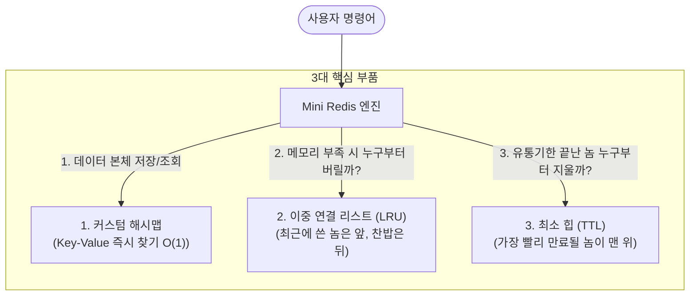

# 📘 밑바닥부터 이해하는 Mini Redis 핵심 자료구조 & 동작 원리

> **이 문서의 목적**: 복잡한 전공 용어를 걷어내고, "헬스장 사물함", "기차놀이", "편의점 알바" 등 직관적인 비유와 실제 코드 동작 원리를 통해 Mini Redis의 3대 핵심 자료구조(해시맵, 이중 연결 리스트, 최소 힙)를 완벽히 마스터합니다.

---

## 📑 목차
1. [전체 큰 그림: 이 고생을 왜 하는가?](#1-전체-큰-그림-이-고생을-왜-하는가)
   - [3대 부품의 협동 구조](#1-1-3대-부품의-협동-구조)
   - [창고는 진짜 몇 개인가? (창고 vs 주소록)](#1-2-창고는-진짜-몇-개인가-창고-vs-주소록)
2. [1장. 해시맵 (Chaining HashMap): 헬스장 사물함과 번호표 계산기](#2-1장-해시맵-chaining-hashmap-헬스장-사물함과-번호표-계산기)
   - [사물함과 djb2 해시 함수](#2-1-사물함과-djb2-해시-함수)
   - [충돌과 체이닝 (사물함 안의 연결 리스트)](#2-2-충돌과-체이닝-사물함-안의-연결-리스트)
   - [리해싱(0.75 로드 팩터)의 오해와 진실](#2-3-리해싱075-로드-팩터의-오해와-진실)
3. [2장. 이중 연결 리스트 & LRU: 손잡고 달리는 기차놀이](#3-2장-이중-연결-리스트--lru-손잡고-달리는-기차놀이)
   - [일반 리스트(배열) vs 이중 연결 리스트](#3-1-일반-리스트배열-vs-이중-연결-리스트)
   - [인덱스가 아니라 '앞뒤 손'만 기억하는 이유](#3-2-인덱스가-아니라-앞뒤-손만-기억하는-이유)
   - [더미 노드(센티넬)와 널 포인터 버그 방어](#3-3-더미-노드센티넬와-널-포인터-버그-방어)
   - [LRU는 선입선출(FIFO)인가?](#3-4-lru는-선입선출fifo인가)
   - [RAM 부족 시 꼴찌를 0초($O(1)$) 만에 찾아 지우는 원리](#3-5-ram-부족-시-꼴찌를-0초o1-만에-찾아-지우는-원리)
4. [3장. 최소 힙 (Min-Heap) & TTL: 가장 급한 놈만 올리는 토너먼트](#4-3장-최소-힙-min-heap--ttl-가장-급한-놈만-올리는-토너먼트)
   - [머지 소트(전체 정렬) vs 최소 힙(우승자 선별)](#4-1-머지-소트전체-정렬-vs-최소-힙우승자-선별)
   - [1등이 빠졌을 때 새 1등을 찾는 원리 (_heapify_down)](#4-2-1등이-빠졌을-때-새-1등을-찾는-원리-_heapify_down)
   - [Redis의 3대 데이터 삭제 정책 완벽 비교](#4-3-redis의-3대-데이터-삭제-정책-완벽-비교)
   - [과거 TTL 찌꺼기(Stale Entry)와 무효화 방어](#4-4-과거-ttl-찌꺼기stale-entry와-무효화-방어)

---

## 1. 전체 큰 그림: 이 고생을 왜 하는가?

### 1-1. 3대 부품의 협동 구조
파이썬의 내장 `dict`나 완성된 Redis를 쓰면 편한데, 왜 굳이 밑바닥부터 짤까요?  
**"Redis가 어떻게 1초에 수십만 건을 $O(1)$로 처리하고, 메모리가 꽉 차도 터지지 않게 관리하는지 그 내부 심장(엔진)을 내 손으로 까보기 위함"**입니다.



---

### 1-2. 창고는 진짜 몇 개인가? (창고 vs 주소록)

> **Q. 해시맵 창고, LRU 창고... 그럼 창고가 2개인가요?**  
> **A. 아닙니다! 진짜 물건(데이터)이 들어있는 창고는 `_storage` 딱 1개뿐입니다!**

* **진짜 창고 (`self._storage = HashMap()`):**
  * 수만 개의 두꺼운 **진짜 물건(데이터: `"Alice"`)**들이 꽂혀있는 유일한 창고입니다.
* **인기 순위 출석부 (`self._lru = LRUManager()`):**
  * 여기엔 **진짜 물건이 단 하나도 없습니다!**
  * 오직 **가벼운 이름표 목걸이(`Node`)**만 끈에 엮여 있는 기차놀이(`_list`)와, 그 이름표의 위치만 찍어주는 검색 컴퓨터(`_node_map`)로 구성된 **"주소록"**일 뿐입니다.

---

## 2. 1장. 해시맵 (Chaining HashMap): 헬스장 사물함과 번호표 계산기

### 2-1. 사물함과 djb2 해시 함수
헬스장에 0번부터 7번까지 적힌 **사물함 8개(버킷, Bucket)**가 있습니다.

```text
[사물함 0] [사물함 1] [사물함 2] [사물함 3] [사물함 4] [사물함 5] [사물함 6] [사물함 7]
```

* **규칙 없는 보관 ($O(N)$의 지옥)**: 아무 데나 쑤셔 넣으면, 철수 짐을 찾으려고 8개 사물함을 다 열어봐야 합니다.
* **마법의 계산기(해시 함수, `djb2`)**: 
  1. `"철수"`라는 이름을 `djb2` 공식에 넣으면 거대한 정수(예: `2144892415`)가 나옵니다.
  2. 사물함 개수(8)로 나눈 나머지(`% 8`)를 구하면 **`3번`**이 나옵니다.
  3. 철수가 짐을 달라고 하면 0번부터 뒤질 필요 없이 **곧바로 3번 사물함 문만 딱 열면 끝**납니다! $\rightarrow$ **$O(1)$ 탐색**

> **💡 왜 단순 덧셈 대신 `djb2`를 쓸까?**  
> 단순 덧셈을 쓰면 `"철수"`와 `"수철"`은 글자 구성이 같아서 무조건 같은 사물함 번호가 나와 충돌합니다. `djb2`는 글자마다 33을 곱하며 비트를 폭발적으로 흔들어 섞어주기 때문에, 글자 하나만 달라도 완전히 다른 사물함으로 골고루 흩뿌려줍니다.

---

### 2-2. 충돌과 체이닝 (사물함 안의 연결 리스트)

새 회원 `"길동"`이 왔는데, 계산기를 돌려보니 하필 또 **`3번`**이 나왔습니다. (충돌, Collision)

* **체이닝(Chaining)**: 사물함 8칸 자체가 연결 리스트인 게 아니라, **3번 사물함 안에서 둘을 `DoublyLinkedList` 줄로 줄줄이 걸어두는 것**입니다!

```text
[사물함 0번] ──> (비어있음)
[사물함 1번] ──> (비어있음)
[사물함 2번] ──> [ 민수 짐 ]
[사물함 3번] ──> [ 철수 짐 ] <──(DoublyLinkedList 줄)──> [ 길동 짐 ]
...
```

길동 짐을 찾을 때는 3번 사물함으로 직행($O(1)$)한 뒤, 걸려있는 2개 짐 중에서 길동 것만 쏙 꺼냅니다.

---

### 2-3. 리해싱(0.75 로드 팩터)의 오해와 진실

> **Q. 사물함 8칸 중 하나라도 0.75를 채우면 16개로 리해싱하나요?**  
> **A. 아닙니다! "전체 8개 사물함에 들어온 총 데이터 개수" 기준입니다!**

$$\text{로드 팩터(Load Factor)} = \frac{\text{전체 저장된 데이터 개수 (size)}}{\text{전체 사물함 개수 (capacity)}} > 0.75$$

* 사물함이 8칸이면 $8 \times 0.75 = 6$개입니다.
* 데이터가 어디에 꽂혀 있든 상관없이, **해시맵 전체 짐이 총 6개를 넘어 7개째가 들어오는 순간 사물함을 16칸으로 2배 확장(리사이징 & 리해싱)**합니다.

> **Q. 한 칸에 3개가 몰려서 총 5개여도 리해싱하나요?**  
> **A. 하지 않습니다!**  
> 컴퓨터 입장에서 줄줄이 엮인 3개 훑어보는 건 0.000001초도 안 걸립니다. 그리고 특정 칸에만 기형적으로 몰리는 일은 `djb2` 계산기가 알아서 골고루 흩뿌려 막아주기 때문에(단순 균등 해싱 가정), 전체 개수가 75%를 넘기 전까지는 비싼 이사(리해싱)를 하지 않습니다.

> **Q. 리해싱은 데이터 다 옮겨야 하니 엄청 오래 걸리지 않나요?**  
> **A. 그 순간은 $O(N)$으로 무겁지만, 가성비(분할 상환 $O(1)$)가 압도적입니다!**  
> 이사를 매일 다니지 않고 짐이 2배로 불어날 때 아주 가끔 하듯이, 수천 번의 $O(1)$ 초고속 연산에 그 비용을 나누면 1회 평균 비용은 여전히 $O(1)$(Amortized $O(1)$)입니다.

---

## 3. 2장. 이중 연결 리스트 & LRU: 손잡고 달리는 기차놀이

### 3-1. 일반 리스트(배열) vs 이중 연결 리스트

| 구분 | 파이썬 일반 리스트 (배열) | 이중 연결 리스트 (Linked List) |
| :--- | :--- | :--- |
| **비유** | **영화관 일렬 좌석** (의자가 다닥다닥 붙음) | **손잡고 서 있는 기차놀이** (손만 잡음) |
| **맨 앞 새치기 (`insert(0)`)** | **느림 ($O(N)$)** <br> 뒤에 앉은 100만 명이 다 한 칸씩 뒤로 밀려남 | **초고속 ($O(1)$)** <br> 맨 앞사람 손만 바꿔 잡으면 0초 만에 끝! |
| **k번째 원소 조회** | **초고속 ($O(1)$)** <br> k번 의자로 바로 직행 | **느림 ($O(N)$)** <br> 1번부터 k번까지 손을 타고 걸어가야 함 |

---

### 3-2. 인덱스가 아니라 '앞뒤 손'만 기억하는 이유
이중 연결 리스트의 노드는 **"내가 몇 번째 줄인지(인덱스)"를 전혀 모릅니다.**  
오직 **내 앞사람 주소(`prev`)**와 **내 뒷사람 주소(`next`)**만 잡고 있습니다.

```python
class Node:
    def __init__(self, key, value):
        self.key = key
        self.value = value
        self.prev = None  # 내 앞사람
        self.next = None  # 내 뒷사람
```
* **장점**: 중간에 누가 끼어들거나 빠져도 다른 사람들의 번호표를 고칠 필요가 전혀 없습니다.
* **Redis에 최적인 이유**: LRU 캐시는 "4번째 녀석 가져와!"를 절대 안 묻습니다. 오직 **"방금 쓴 놈 맨 앞으로 옮겨!"**, **"제일 오래된 꼴찌 버려!"**만 하기 때문에 손잡기만 빠른 연결 리스트가 제격입니다.

---

### 3-3. 더미 노드(센티넬)와 널 포인터 버그 방어

> **💡 널 포인터 버그(Null Pointer Bug / NPE)란?**  
> 주소가 적혀있지 않은 텅 빈 쪽지(`None / Null`)인데, 진짜 집이 있는 줄 알고 `"그 집 문 열어!"(`node.next.value`)` 했다가 컴퓨터가 뻗어버리는(`AttributeError`) 버그.

* **더미 노드가 없을 때의 비극**:  
  맨 앞 노드를 지우려고 `node.prev.next = node.next`를 실행하면, 내 앞사람이 없으니 `None.next`가 되어 즉시 서버가 폭발합니다.
* **해결책 (양끝의 가짜 기둥)**:  
  양끝에 영원히 사라지지 않는 출발 깃발(`Dummy Head`)과 도착 깃발(`Dummy Tail`)을 박아둡니다.
  ```text
  [Dummy Head] <───> [실제 데이터 1] <───> [실제 데이터 2] <───> [Dummy Tail]
  ```
  이제 모든 실제 노드는 **언제나 앞뒤 이웃이 100% 존재**하므로, 복잡한 if문 없이 단 2줄로 안전하게 삭제합니다:
  ```python
  node.prev.next = node.next
  node.next.prev = node.prev
  ```

---

### 3-4. LRU는 선입선출(FIFO)인가?

> ⚠️ **주의! LRU는 단순 선입선출(FIFO)이 아닙니다!**

* **FIFO (First-In, First-Out, 선입선출)**:  
  먼저 들어온 녀석이 무조건 먼저 나갑니다. 중간에 손님이 그 물건을 아무리 많이 찾아도 순서가 안 바뀝니다.
* **LRU (Least Recently Used, 최근 최소 사용)**:  
  먼저 들어왔더라도, 손님이 중간에 `GET`으로 조회하면 **"방금 쓰였음!" 하고 즉시 맨 앞(`Head`)으로 순간이동**합니다!  
  결국 맨 뒤(`Tail`)로 밀려나 버려지는 녀석은 "먼저 들어온 놈"이 아니라 **"오랫동안 아무도 찾지 않은 가장 인기 없는 찬밥 신세"**입니다.

---

### 3-5. RAM 부족 시 꼴찌를 0초($O(1)$) 만에 찾아 지우는 원리

> **Q. 사물함 안에는 순서가 없는데, 지워야 할 꼴찌가 누구인지 어떻게 알고 지우나요?**  
> **A. 항상 뒤에서 돌고 있는 '기차놀이'의 맨 마지막 빈 기둥(`self.tail`)에게 물어봅니다!**

```text
[Dummy Head] <──> [user:1] <──> [user:3] <──> [user:2] <──> [Dummy Tail (항상 있는 빈 기둥)]
                                               ▲                  │
                                               │                  │
                                               └──(self.tail.prev)┘
                                                  "테일아, 네 앞사람 손잡은 놈 누구야?"
```

1. **실시간 순서 기억**: 손님이 건드릴 때마다 이름표를 맨 앞(`Head 바로 뒤`)에 세우므로, 안 불린 녀석은 자연스럽게 맨 뒤로 밀려납니다.
2. **꼴찌 낚아채기 (`lru_cache.py` / `doubly_linked_list.py`)**:
   ```python
   def remove_back(self):
       # 항상 그 자리에 서 있는 빈 기둥(self.tail)에게
       # "네 앞사람(self.tail.prev) 누구야?" 물어보고 그 녀석을 0초 만에 지운다!
       return self.remove_node(self.tail.prev)
   ```
3. **사물함에서 진짜 물건 폐기**:
   대열에서 빠진 꼴찌 노드의 명찰 이름(`"user:2"`)을 확인하고, 진짜 사물함 창고(`_storage`)로 가서 그 물건을 버립니다!

---

## 4. 3장. 최소 힙 (Min-Heap) & TTL: 가장 급한 놈만 올리는 토너먼트

### 4-1. 머지 소트(전체 정렬) vs 최소 힙(우승자 선별)
* **머지 소트 (Merge Sort)**: 전교생 성적표를 1등부터 꼴찌까지 **완벽한 일렬 종대로 줄 세우는 알고리즘** ($O(N \log N)$).
* **최소 힙 (Min-Heap)**: 2등, 3등 서열에는 관심 없고, **"가장 유통기한이 급한 1등"만 항상 꼭대기(루트)에 올려두는 토너먼트 바구니** ($O(1)$ 확인).

```text
       [1등: 10초 뒤 만료]  <--- 꼭대기(루트): 1등만 올라옴!
            /         \
   [30초 뒤]           [20초 뒤]
     /    \              /
[60초]   [50초]       [40초]
```

---

### 4-2. 1등이 빠졌을 때 새 1등을 찾는 원리 (`_heapify_down`)

> **Q. 1등을 지우면 처음부터 10만 개를 다 다시 계산해서 새 1등을 찾아야 하나요?**  
> **A. 절대 아닙니다! 계단을 몇 번만 내려보내는 하향 정돈(`_heapify_down`)으로 $O(\log N)$만에 찾습니다!**

```text
1단계: 1등을 빼고, 맨 밑바닥 꼴찌[40초]를 꼭대기 왕좌에 임시로 앉힘.
2단계: [40초]가 자기 바로 밑의 두 자식([20초] vs [30초])과만 딱 비교함.
3단계: 더 급한 [20초]가 새 1등으로 올라가고, [40초]는 한 계단 아래로 내려감.
```

* **놀라운 속도**: 데이터가 **100만 개**여도 트리의 높이는 **겨우 20층**입니다 ($2^{20} \approx 100만$).  
  처음부터 100만 개를 다 뒤지는 게 아니라, **계단을 딱 20번만 내려가며 비교하면 새로운 1등이 바로 결정**됩니다! ($O(\log N)$)

---

### 4-3. Redis의 3대 데이터 삭제 정책 완벽 비교

| 번호 | 정책 이름 | 동작 시점 | 편의점 비유 |
| :---: | :--- | :--- | :--- |
| **1** | **지연 검사<br>(Lazy Deletion)** | 손님이 **그 데이터(`key`)를 달라고 했을 때** | 손님이 가져온 삼각김밥 유통기한을 보고 그 자리에서 폐기 |
| **2** | **능동 청소<br>(Active Scrubbing)** | `DBSIZE` 등 **전체 조회가 들어왔을 때** | 손님이 시키지도 않았는데, 알바생이 힙 꼭대기 보고 상한 김밥들을 알아서 쓰레기통에 쓸어 담음 |
| **3** | **LRU 방출<br>(LRU Eviction)** | **메모리(`maxmemory`)가 꽉 찼을 때** | 신상 과자 놓을 자리가 없어서, 제일 오랫동안 안 팔린 비인기 상품을 매대에서 빼버림 |

> **💡 왜 2번이 '능동'인가?**  
> 손님이 특정 물건을 달라고 하지 않았는데도, 컴퓨터가 **스스로 힙 꼭대기를 훑어보며 상한 것들을 빗자루질**하기 때문에 '능동적'이라고 부릅니다.

---

### 4-4. 과거 TTL 찌꺼기(Stale Entry)와 무효화 방어

1. `SET mykey "과자"` 후 10초 만료를 걸었습니다.  
   $\rightarrow$ 최소 힙에 `(10초 뒤, "mykey")` 쪽지가 들어감.
2. 3초 뒤, `SET mykey "새 과자"`로 덮어썼습니다. (유통기한 초기화)  
   $\rightarrow$ 진짜 장부(`_expire_map`)에서는 유통기한을 지웠지만, **힙 깊숙한 곳의 옛날 쪽지는 찾는 게 너무 느려서($O(N)$) 그냥 방치**합니다. (과거 찌꺼기)
3. 10초 뒤, 힙 꼭대기에서 그 옛날 쪽지가 튀어나옵니다!
4. **무효화 방어**:  
   시스템이 진짜 장부와 대조해보고 *"어? 장부에는 `mykey`가 영구 보관인데?"* 하고 알아챈 뒤, **`mykey` 데이터는 건드리지 않고 옛날 쪽지만 조용히 쓰레기통에 버립니다.**